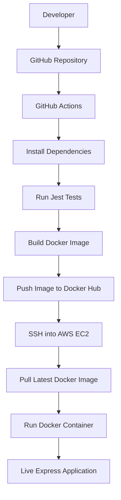

# Automated CI/CD Pipeline – Express TypeScript Application

[](https://github.com/nikhil19d/express-ts-app/actions/workflows/ci-cd.yml)


## Project Overview

This project demonstrates an automated Continuous Integration and Continuous Deployment (CI/CD) pipeline for a Node.js Express application built using TypeScript.

The pipeline uses GitHub Actions to automate testing, Docker image creation, publishing to Docker Hub, and deployment to an AWS EC2 instance.

## Technology Stack

- Node.js
- TypeScript
- Express.js
- Jest and Supertest
- Docker
- Docker Compose
- GitHub Actions
- Docker Hub
- AWS EC2 (t3.micro)

## CI/CD Architecture



## Pipeline Workflow

1. Developer pushes code to the GitHub repository.
2. GitHub Actions automatically triggers the CI/CD workflow.
3. Dependencies are installed.
4. Jest and Supertest execute automated tests.
5. Docker image is built.
6. Docker image is pushed to Docker Hub.
7. GitHub Actions connects to AWS EC2 using SSH.
8. EC2 pulls the latest Docker image.
9. The application container is restarted.

## Business Impact

- **Automation:** Reduces manual deployment effort through automated CI/CD.
- **Reliability:** Automated tests help identify application issues before deployment.
- **Faster delivery:** Enables consistent and repeatable application releases.

## Infrastructure

- AWS EC2 – t3.micro
- Docker container deployment
- GitHub Actions for CI/CD automation
- Docker Hub for image storage
- EC2 infrastructure provisioned manually through AWS Console.

## Run Locally

```bash
npm install
npm test
docker compose up --build
```

## Application Deployment

Push changes to the `main` branch to trigger the GitHub Actions pipeline.

## Live Application

curl -i http://3.25.166.129:3000/health

## Author

Nikhil Kodukula
